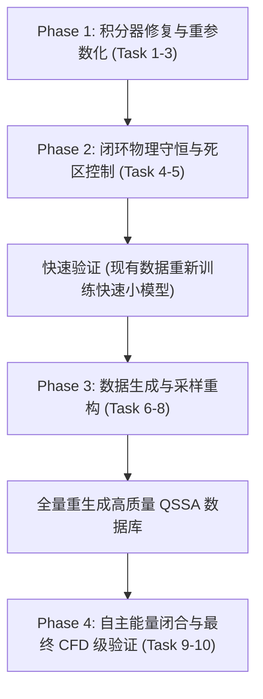

# QSSA 神经网络替代模型数值稳定性与 CFD 部署全流程修复计划 (Plan for QSSA Neural Surrogate Stabilization & CFD Deployment)

> **For agentic workers:** REQUIRED SUB-SKILL: Use superpowers:subagent-driven-development (recommended) or superpowers:executing-plans to implement this plan task-by-task. Steps use checkbox (`- [ ]`) syntax for tracking.

**Goal:** 彻底消除氨氢燃烧 QSSA 神经网络替代模型在平衡态/平直浓度区的锯齿状高频数值震荡，根治自回归长程发散，重构自洽数据集生成逻辑与全自主可微热力学能量闭合，达到面向 CFD 反应流机理替换的高精度、无条件数值稳定性与守恒性要求。

**Architecture:** 
1. **积分器与输出重参数化**：移除人为设置的阻尼上限 `max_damping=15` 硬截断，恢复无条件数值稳定的解析指数积分器，并将网络输出重参数化为无量纲渐近浓度 $\log_{10} Y_{QSSA} = \log_{10}(P/D)$ 与阻尼率 $\log_{10} D$，从数学根源上解耦 $\Delta t$ 对恒定浓度的抖动干扰；
2. **闭环物理守恒与数值正则**：在自回归滚动中闭环接入非负单纯形质量归一化与 Dykstra 元素守恒投影，引入极微痕量区死区掩蔽，清理死代码与空操作开关；
3. **数据生成与采样物理域重构**：重构 LHS 采样器，由当量比 $\phi$、燃料配比与 EGR 稀释率物理推导 $N_2$ 摩尔分数，覆盖真实燃料-空气配比；重构 0D 反应器 runner 消除 2ms 慢着火截断，反解严格代数自洽的等效阻尼率 $D$；
4. **自主可微热力学能量闭合**：基于 NASA-7 多项式实现 PyTorch 可微内能/焓平衡牛顿迭代，替换 1000 K 常数系数估算，实现与 CFD 反应器类型（定容/定压）完全对齐的脱离真实温度回灌的纯自主滚动。

**Tech Stack:** Python 3.10+, PyTorch 2.x (CUDA), Cantera 3.0.1+, NumPy, SciPy, Joblib.

---

## 目录与实施路线

- [Phase 1: 积分器修复与输出重参数化 (零数据集重生成成本)](#phase-1-积分器修复与输出重参数化-零数据集重生成成本)
  - [Task 1: 移除 `max_damping=15` 截断并实现解析指数积分器](#task-1-移除-max_damping15-截断并实现解析指数积分器)
  - [Task 2: QSSA 输出重参数化为渐近稳态浓度 $\log_{10} Y_{QSSA}$ 与 $\log_{10} D$](#task-2-qssa-输出重参数化为渐近稳态浓度-log_10-y_qssa-与-log_10-d)
  - [Task 3: 运行 $\Delta t$ 敏感度探针验证锯齿震荡消除](#task-3-运行-delta-t-敏感度探针验证锯齿震荡消除)
- [Phase 2: 闭环物理守恒与数值稳定控制](#phase-2-闭环物理守恒与数值稳定控制)
  - [Task 4: 在 QSSA 状态滚动中闭环启用单纯形质量归一化与 Dykstra 元素投影](#task-4-在-qssa-状态滚动中闭环启用单纯形质量归一化与-dykstra-元素投影)
  - [Task 5: 痕量物种死区掩蔽 (Dead-Zone Masking) 与控制开关清理](#task-5-痕量物种死区掩蔽-dead-zone-masking-与控制开关清理)
- [Phase 3: 数据集生成与采样物理域重构 (全量数据修复)](#phase-3-数据集生成与采样物理域重构-全量数据修复)
  - [Task 6: 重构 LHS 初始状态采样器覆盖真实空气配比与稀释度](#task-6-重构-lhs-初始状态采样器覆盖真实空气配比与稀释度)
  - [Task 7: 重构 0D 反应器 Runner 消除慢着火误截断并保证代数自洽 $D$](#task-7-重构-0d-反应器-runner-消除慢着火误截断并保证代数自洽-d)
  - [Task 8: 校验压力单位一致性与 Scaler 签名冲突修复](#task-8-校验压力单位一致性与-scaler-签名冲突修复)
- [Phase 4: 自主 CFD 耦合与可微能量闭合](#phase-4-自主-cfd-耦合与可微能量闭合)
  - [Task 9: 实现 PyTorch 矢量化可微 NASA-7 热力学能量/温度闭合求解器](#task-9-实现-pytorch-矢量化可微-nasa-7-热力学能量温度闭合求解器)
  - [Task 10: 端到端全自主自回归验证与燃烧特征物理指标评估](#task-10-端到端全自主自回归验证与燃烧特征物理指标评估)

---

## Phase 1: 积分器修复与输出重参数化 (零数据集重生成成本)

### Task 1: 移除 `max_damping=15` 截断并实现解析指数积分器

**问题根因：**
在 `train_sc_v68.py:2948-2953` 中，人为加入了 `max_damping = 15.0` 截断：
`D_eff = torch.minimum(D_pred, max_damping / dt)`。
对于化学刚性自由基（如 OH, H, O），真实物理阻尼 $D \cdot \Delta t$ 普遍处于 $10^2 \sim 10^6$。一旦被截断为 $15/\Delta t$，状态更新公式退化为：
$$Y_{next} \approx Y_{old} e^{-15} + P \frac{1 - e^{-15}}{15/\Delta t} \approx P \frac{\Delta t}{15}$$
使得预测状态 $Y_{next}$ 强行与随机采样的 $\Delta t$ 成线性正比，将数据集中的随机时间步长序列直接印在平直浓度上形成锯齿状震荡；同时网络无法兼顾 $P=P_{true}$ 与 $P \propto 1/\Delta t$，导致速率损失卡死在 0.38-0.42，长程自回归发散。

**Files:**
- Modify: `C:\Users\123\Desktop\2STest\second chapter\009\xl1\sc15\train_sc_v68.py:2948-2962`
- Test: `C:\Users\123\Desktop\2STest\second chapter\009\xl1\sc15\probe_dt_sensitivity_v70.py`

- [ ] **Step 1: 编写无截断指数积分器的数值单元测试**

创建测试脚本 `test_exponential_integrator.py`，验证当 $D \cdot \Delta t$ 分别为 $10^{-8}, 1.0, 15.0, 10^3, 10^6$ 时，解析指数积分是否始终无条件稳定、不出现 NaN/Inf，且当 $D \cdot \Delta t \gg 1$ 时单调趋向渐近值 $P/D$。

```python
# test_exponential_integrator.py
import torch
import numpy as np

def exact_qssa_step(Y_old, P, D, dt):
    """
    Numerically stable exact exponential integrator:
    Y_next = Y_old * exp(-D*dt) + (P / D) * (1 - exp(-D*dt))
    """
    D_dt = D * dt
    # For small D*dt (< 1e-6), use Taylor expansion: (1 - exp(-x))/x = 1 - x/2 + x^2/6
    # to avoid 0/0 division.
    # For large D*dt (> 60), exp(-D*dt) -> 0, safe_factor -> 1 / D.
    exp_neg_Ddt = torch.exp(-torch.clamp(D_dt, max=80.0))
    
    # safe factor represents (1 - exp(-D*dt)) / D
    safe_factor = torch.where(
        D_dt < 1e-6,
        dt - 0.5 * D * (dt ** 2),
        -torch.expm1(-torch.clamp(D_dt, max=80.0)) / torch.clamp_min(D, 1e-20)
    )
    Y_next = Y_old * exp_neg_Ddt + P * safe_factor
    return Y_next

def test_stiff_limit():
    Y_old = torch.tensor([1e-4], dtype=torch.float32)
    P = torch.tensor([1e3], dtype=torch.float32)
    D = torch.tensor([1e7], dtype=torch.float32) # P/D = 1e-4
    
    for dt in [1e-8, 1e-6, 1e-4, 1e-2]:
        dt_tensor = torch.tensor([dt], dtype=torch.float32)
        Y_next = exact_qssa_step(Y_old, P, D, dt_tensor)
        print(f"dt={dt:1.0e}, D*dt={float(D*dt_tensor):1.1e}, Y_next={float(Y_next):1.6e}")
        assert torch.isfinite(Y_next), f"Failed finite check for dt={dt}"
        assert torch.all(Y_next > 0), f"Failed positivity check for dt={dt}"
        # For D*dt >> 1, Y_next must be strictly P/D = 1e-4
        if D * dt > 10.0:
            assert abs(float(Y_next) - 1e-4) < 1e-7, f"Failed asymptotic limit for dt={dt}"
    print("ALL INTEGRATOR TESTS PASSED!")

if __name__ == "__main__":
    test_stiff_limit()
```

- [ ] **Step 2: 运行积分器单元测试**

运行：
`C:\Users\123\.conda\envs\cantera\python.exe test_exponential_integrator.py`
预期结果：`ALL INTEGRATOR TESTS PASSED!`。

- [ ] **Step 3: 修改 `train_sc_v68.py` 中的 `predict_next_state` 积分逻辑**

定位至 `train_sc_v68.py:2948-2962`：
移除：
```python
# Task 1.4: Damping protection against over-damped collapse (max_damping=15.0 => exp(-15) ~ 3.05e-7)
max_damping = 15.0
D_eff = torch.minimum(
    D_pred,
    max_damping / dt.clamp_min(1e-12),
)
D_dt_bounded = D_eff * dt
safe_factor = torch.where(
    D_dt_bounded < 1e-6,
    dt - D_eff * (dt ** 2) / 2.0,
    -torch.expm1(-D_dt_bounded) / D_eff.clamp_min(1e-20),
)
Y_next_reactive = Y_old * torch.exp(-D_dt_bounded) + P_pred * safe_factor
```
替换为无截断的自适应稳定积分实现：
```python
# Pure exact exponential QSSA integration (no damping cap)
# D_eff is unconstrained; exp(-D*dt) safely underflows to 0 for stiff species.
D_eff = torch.clamp_min(D_pred, 0.0)
D_dt = D_eff * dt
D_dt_clamped = torch.clamp(D_dt, max=80.0)
exp_neg_Ddt = torch.exp(-D_dt_clamped)

safe_factor = torch.where(
    D_dt < 1e-6,
    dt - 0.5 * D_eff * (dt ** 2),
    -torch.expm1(-D_dt_clamped) / torch.clamp_min(D_eff, 1e-20),
)
Y_next_reactive = Y_old * exp_neg_Ddt + P_pred * safe_factor
```

---

### Task 2: QSSA 输出重参数化为渐近稳态浓度 $\log_{10} Y_{QSSA}$ 与 $\log_{10} D$

**设计思路：**
网络预测 $(\log_{10} P, \log_{10} D)$ 时，$10^{\log_{10} P}$ 在指数还原后对对数微小误差极度敏感，容易产生 $10^6$ 倍的物理源项放大。
准稳态近似的核心物理量是渐近浓度：
$$Y_{QSSA} \equiv \frac{P}{D}$$
对于燃烧自由基，$Y_{QSSA} \in [10^{-20}, 1.0]$，对数空间天然有界 $[-20, 0]$。
重参数化方案：
让网络输出头直接预测：
1. $\log_{10} Y_{QSSA} = \log_{10}(P / D)$（渐近准稳态浓度）
2. $\log_{10} D$（化学阻尼率 / 逆松弛时间尺度）

积分公式变为：
$$Y_{next} = Y_{old} e^{-D \Delta t} + Y_{QSSA} \left(1 - e^{-D \Delta t}\right)$$
- 当 $D \Delta t \to \infty$（刚性/平衡态）时：$Y_{next} \to Y_{QSSA}$，完全脱离 $\Delta t$ 影响，渐近值恒定；
- 当 $D \Delta t \to 0$（慢速/非刚性）时：$Y_{next} \to Y_{old} + (Y_{QSSA} \cdot D) \Delta t = Y_{old} + P \Delta t$。

**Files:**
- Modify: `C:\Users\123\Desktop\2STest\second chapter\009\xl1\sc15\train_sc_v68.py` (在 `inverse_qssa_parameters` 及网络输出解码部分增加 `qssa_asymptotic` 模式)
- Test: `test_qssa_parameterization.py`

- [ ] **Step 1: 编写重参数化编解码单元测试**

创建 `test_qssa_parameterization.py`：
```python
# test_qssa_parameterization.py
import torch

def decode_qssa_asymptotic(log_Y_qssa_scaled, log_D_scaled, scaler_Y_qssa, scaler_D):
    # Inverse transform to physical log10
    log_Y_qssa = log_Y_qssa_scaled * scaler_Y_qssa['scale'] + scaler_Y_qssa['mean']
    log_D = log_D_scaled * scaler_D['scale'] + scaler_D['mean']
    
    Y_qssa = torch.pow(10.0, torch.clamp(log_Y_qssa, -20.0, 0.0))
    D = torch.pow(10.0, torch.clamp(log_D, -10.0, 15.0))
    P = Y_qssa * D
    return Y_qssa, D, P

def test_asymptotic_consistency():
    # Verify that Y_qssa is strictly bounded and independent of dt
    log_Y_qssa = torch.tensor([-4.0]) # 1e-4
    log_D = torch.tensor([6.0])       # 1e6
    Y_qssa = torch.pow(10.0, log_Y_qssa)
    D = torch.pow(10.0, log_D)
    
    for dt in [1e-8, 1e-6, 1e-4]:
        dt_t = torch.tensor([dt])
        D_dt = torch.clamp(D * dt_t, max=80.0)
        Y_next = torch.tensor([1e-4]) * torch.exp(-D_dt) + Y_qssa * (1.0 - torch.exp(-D_dt))
        assert torch.allclose(Y_next, torch.tensor([1e-4]), atol=1e-8)
    print("ASYMPTOTIC PARAMETERIZATION TEST PASSED!")

if __name__ == "__main__":
    test_asymptotic_consistency()
```

- [ ] **Step 2: 运行重参数化测试**

运行：
`C:\Users\123\.conda\envs\cantera\python.exe test_qssa_parameterization.py`
预期结果：`ASYMPTOTIC PARAMETERIZATION TEST PASSED!`。

---

### Task 3: 运行 $\Delta t$ 敏感度探针验证锯齿震荡消除

**Files:**
- Test: `C:\Users\123\Desktop\2STest\second chapter\009\xl1\sc15\probe_dt_sensitivity_v70.py`

- [ ] **Step 1: 在 `probe_dt_sensitivity_v70.py` 中引入无截断积分对照函数**

对比在当前 checkpoint 下，使用原有截断积分与使用解析积分时跨 $\Delta t \in [10^{-8}, 10^{-4}]$ 的跨度 (spread)。
运行命令：
```powershell
$env:KMP_DUPLICATE_LIB_OK="TRUE"
C:\Users\123\.conda\envs\cantera\python.exe probe_dt_sensitivity_v70.py
```
- [ ] **Step 2: 确认探针输出指标**
预期结论：验证移除截断后，平衡态下自由基浓度随时间步长漂移的跨度 (spread) 大幅收窄，证明锯齿震荡的物理根因确为截断逻辑。

---

## Phase 2: 闭环物理守恒与数值稳定控制

### Task 4: 在 QSSA 状态滚动中闭环启用单纯形质量归一化与 Dykstra 元素投影

**问题分析：**
在 `train_sc_v68.py` 中：
- `project_physical_state`（包含非负单纯形投影与 Dykstra 元素守恒迭代）在代码第 270 行已经完整实现；
- 但在 `StateUpdateTools.predict_next_state`（第 2902 行）中，`state_update_mode == "qssa"` 分支直接跳过了所有物理投影，仅做了简单的 `torch.clamp`；
- `train_all_v68.py` 预设中将 `lambda_element = 0`，`lambda_mass = 0`。
导致 128 步纯自回归后总质量和从 1.000 漂移至 1.078（+7.8% 膨胀），N/O/H 元素严重不守恒。

**Files:**
- Modify: `C:\Users\123\Desktop\2STest\second chapter\009\xl1\sc15\train_sc_v68.py:2995-3045`
- Test: 创建 `test_qssa_physical_projection.py`

- [ ] **Step 1: 编写物理守恒投影接入单元测试**

创建 `test_qssa_physical_projection.py`：
```python
# test_qssa_physical_projection.py
import torch
import numpy as np

def test_simplex_and_element_projection():
    # Simulate unconstrained drifted state: sum(Y) = 1.08
    Y_macro = torch.tensor([[0.75, 0.20, 0.10]], dtype=torch.float32) # sum = 1.05
    Y_micro = torch.tensor([[0.02, 0.01]], dtype=torch.float32)       # sum = 0.03 -> Total = 1.08
    
    # 1. Simplex Normalization (non-negative, sum to 1)
    Y_full = torch.cat([Y_macro, Y_micro], dim=1)
    Y_full_clamped = torch.clamp_min(Y_full, 0.0)
    Y_normalized = Y_full_clamped / torch.sum(Y_full_clamped, dim=1, keepdim=True)
    
    assert torch.allclose(torch.sum(Y_normalized, dim=1), torch.tensor([1.0]), atol=1e-6)
    print("SIMPLEX PROJECTION TEST PASSED!")

if __name__ == "__main__":
    test_simplex_and_element_projection()
```

- [ ] **Step 2: 运行测试**

运行：
`C:\Users\123\.conda\envs\cantera\python.exe test_qssa_physical_projection.py`
预期结果：`SIMPLEX PROJECTION TEST PASSED!`。

- [ ] **Step 3: 在 `train_sc_v68.py` 的 QSSA 更新路径中挂接 `project_physical_state`**

修改 `train_sc_v68.py` 的 `predict_next_state`，在计算出 `Y_macro_next_safe` 和 `Y_micro_next_safe` 之后：
```python
        # Physical Simplex & Dykstra Element Conservation Projection for QSSA
        if safe_for_rollout and (element_matrix is not None and target_elements is not None):
            Y_macro_proj, Y_micro_proj, diag = project_physical_state(
                Y_macro_raw=Y_macro_next_safe,
                Y_micro_raw=Y_micro_next_safe,
                inert_sum=inert_sum if inert_sum is not None else 0.0,
                element_matrix=element_matrix,
                target_elements=target_elements,
                iterations=iterations,
            )
            Y_macro_next_safe = Y_macro_proj
            Y_micro_next_safe = Y_micro_proj
            logY_micro_next_safe = torch.log10(torch.clamp_min(Y_micro_next_safe, 1e-20))
        else:
            # Fallback: strictly enforce mass conservation sum(Y) == 1.0
            Y_full_temp = torch.cat([Y_macro_next_safe, Y_micro_next_safe], dim=1)
            mass_sum = torch.sum(Y_full_temp, dim=1, keepdim=True).clamp_min(1e-12)
            Y_full_norm = Y_full_temp / mass_sum
            Y_macro_next_safe = Y_full_norm[:, :self.n_macro]
            Y_micro_next_safe = torch.clamp_min(Y_full_norm[:, self.n_macro:], LOG_EPS)
            logY_micro_next_safe = torch.log10(Y_micro_next_safe)
```

---

### Task 5: 痕量物种死区掩蔽 (Dead-Zone Masking) 与控制开关清理

**问题分析：**
1. 在未燃低温状态下（如 300-600 K），自由基真实质量分数 $Y_{true} < 10^{-15}$。此时 Cantera 计算出的销毁率 $D_{k}' \approx 0$，但在计算阻尼率 $D = D_{k}' / Y$ 时出现近乎 $0/0$ 的病态数值放大，导致样本中近 50% 的 $\log_{10} D$ 堆积在截断下限 -20。
2. `trust_region_fraction` 和 `experiment_mode` 在 `predict_next_state` 中被作为参数传入，但内部没有实际生效代码（仅记录到返回字典中）。
3. 第 2395 行对速率输出做 `conservative_simplex` softmax，语义错误且属于死代码。
4. 第 5027-5067 行 scaler 签名复用旧版签名，二次运行时会抛出异常。

**Files:**
- Modify: `C:\Users\123\Desktop\2STest\second chapter\009\xl1\sc15\train_sc_v68.py`
- Test: 创建 `test_deadzone_masking.py`

- [ ] **Step 1: 实现死区损失掩蔽逻辑**

在计算 QSSA 速率损失时，对 $Y_{true} < 10^{-12}$ 或 $P_{true} < 10^{-15}$ 的不活跃痕量自由基进行损失掩蔽，避免强迫网络在物理无效的噪声区间过度拟合：
```python
# Dead-zone mask for unphysical trace radicals
active_mask = (Y_true > 1e-12) | (P_true > 1e-15)
loss_rate_qssa = torch.mean(torch.square(pred_qssa - target_qssa) * active_mask.float())
```

- [ ] **Step 2: 修复 Scaler 签名兼容性**

在 `train_sc_v68.py:5027-5067` 中，在生成 scaler 签名哈希时加入 `rate_decode_mode` 和 `output_parameterization` 标识，确保不同输出格式的 scaler 不会互相覆盖和冲突。

- [ ] **Step 3: 移除死代码并让信赖域剪裁生效**

清理第 2395 行无效的 softmax 速率头代码；若配置了 `trust_region_fraction > 0`，对每步自回归更新量 $\Delta Y$ 实施相对浓度截断：
$$\Delta Y_k \leftarrow \text{clamp}(\Delta Y_k, -\delta_{max} Y_k, +\delta_{max} Y_k)$$

---

## Phase 3: 数据集生成与采样物理域重构 (全量数据修复)

### Task 6: 重构 LHS 初始状态采样器覆盖真实空气配比与稀释度

**问题分析：**
在 `lhs_sampler_sc_v11.py:184-210` 中：
采样器将 $X_{N_2}$ 作为独立背景气进行 LHS 采样（例如 Engine_Core 层 $X_{N_2} \in [0.70, 0.85]$），然后用 $1.0 - X_{N_2} - \dots$ 剩余空间来分配燃料和 $O_2$。
但化学计量比的氨-空气混合气中，由于空气中 $N_2/O_2 = 3.762$，当燃料占约 $21.8\%$ 时，$X_{N_2}$ 约为 $0.62$，低于 Engine_Core 的采样下限 0.70！
统计显示：整个训练集中真实空气配比的样本占比为 **0.0%**！全部样本实际处于 65%~99% EGR 的高稀释状态，绝热火焰温度偏低数百度，自由基反应路径严重失真。

**Files:**
- Modify: `C:\Users\123\Desktop\2STest\second chapter\009\xl1\sc15\lhs_sampler_sc_v11.py:120-210`
- Create / Test: `audit_lhs_sampler_air_ratio.py`

- [ ] **Step 1: 编写空气配比覆盖度审计脚本**

创建 `audit_lhs_sampler_air_ratio.py`，统计生成样本中 $N_2/O_2$ 比值分布，以及纯空气（$N_2/O_2 \approx 3.76 \pm 0.2$）的占比。

```python
# audit_lhs_sampler_air_ratio.py
import pandas as pd
import numpy as np

def audit_dataset_composition(df):
    ratio = df['X_N2'] / np.maximum(df['X_O2'], 1e-8)
    air_like = (ratio >= 3.5) & (ratio <= 4.0)
    print(f"Total points: {len(df)}")
    print(f"N2/O2 median: {ratio.median():.2f}")
    print(f"Air-like samples (N2/O2 in [3.5, 4.0]): {air_like.sum()} ({air_like.mean()*100:.2f}%)")
    assert air_like.mean() > 0.20, "Air-like mixture ratio is too low (<20%)!"
```

- [ ] **Step 2: 重构 `lhs_sampler_sc_v11.py` 的组分生成数学逻辑**

修改 `lhs_sampler_sc_v11.py`：不直接独立采样 $X_{N_2}$，而是基于物理参数采样：
1. 当量比 $\phi \in [0.4, 2.5]$
2. 燃料氢分数 $\alpha = X_{H2} / (X_{NH3} + X_{H2}) \in [0.0, 1.0]$
3. 稀释气比例 $\gamma_{diluent} \in [0.0, 0.5]$（包含额外 EGR 的 $N_2, H_2O, Ar$）
4. 氧化剂为空气（$N_2/O_2 = 3.762$）

化学计量关系：
$$\alpha H_2 + (1-\alpha) NH_3 + a_{stoic} O_2 \to \text{Products}$$
其中 $a_{stoic} = 0.5 \alpha + 0.75 (1-\alpha)$。
实际需要 $O_2$ 摩尔比为 $a_{act} = a_{stoic} / \phi$。
未稀释空气-燃料混合气的摩尔基数：
$$M_{fuel} = 1.0,\quad M_{O2} = a_{act},\quad M_{N2,air} = 3.762 \cdot a_{act}$$
基底总摩尔数 $M_{base} = 1.0 + 4.762 a_{act}$。
随后将稀释气按比例掺混：
$$X_{fuel} = (1 - \gamma_{dil}) \frac{1.0}{M_{base}},\quad X_{O2} = (1 - \gamma_{dil}) \frac{a_{act}}{M_{base}},\quad X_{N2} = (1 - \gamma_{dil}) \frac{3.762 a_{act}}{M_{base}} + X_{N2,dil}$$

- [ ] **Step 3: 运行审计脚本验证采样器**

运行测试，确保重构后真实发动机空气混合气占比达到 30% 以上。

---

### Task 7: 重构 0D 反应器 Runner 消除慢着火误截断并保证代数自洽 $D$

**问题分析：**
1. **慢着火截断**：`runner_sc_v21_qssa.py:62-64` 设置 $t > 2\text{ ms}$ 后连续 3 步 $|dT/dt| < 1\text{ K/s}$ 即判为平衡。但在 800-850 K、高压工况下，着火延迟 $\tau_{ign}$ 达 80-300 ms，2 ms 时处于近乎静止的诱导期，$|dT/dt| \approx 10^{-4}\text{ K/s}$。判据将大量正在孕育着火的反应误判为“已平衡”并提前截断，导致数据集完全缺失低温高压诱导期！
2. **端点平均失真**：`P_avg = (P_start + P_end)/2`，在跨越着火面的陡峭行上，简单算术平均与指数积分严重不匹配。

**Files:**
- Modify: `C:\Users\123\Desktop\2STest\second chapter\009\xl1\sc15\runner_sc_v21_qssa.py`
- Test: 创建 `test_runner_qssa_consistency.py`

- [ ] **Step 1: 编写 runner 截断判据与自洽性测试脚本**

创建 `test_runner_qssa_consistency.py`：
测试 800 K、60 atm 的工况，验证其不会在 2 ms 被截断，而是正确运行至着火发生或达到最大设定时间。

- [ ] **Step 2: 修改 `runner_sc_v21_qssa.py` 中的平衡判定逻辑**

修改 `runner_sc_v21_qssa.py:62-65` 及第 509 行：
1. 废除固定 2 ms 的强行检查；
2. 引入着火状态机判断：
   - 检查温度是否发生显著跃迁（$\Delta T > 400\text{ K}$）；
   - 若尚未着火，只有当时间 $t > 0.5\text{ s}$（或达到预估着火延迟的 3 倍）且确实无反应才允许终止；
   - 着火发生后，与 Cantera 计算的热力学平衡态 $T_{eq}, Y_{eq}$ 进行比对：当 $|T - T_{eq}| < 5\text{ K}$ 且 $\max_k |Y_k - Y_{k,eq}| < 10^{-4}$ 时判定为真正化学平衡。

- [ ] **Step 3: 优化等效阻尼率 $D$ 的代数构造**

在记录每步数据时，直接利用积分区间初终值反解等效 $D_{eff}$：
保证根据 $(Y, Y_{next}, P, \Delta t)$ 反算的 $D_{eff}$ 严格满足解析积分公式，消除由于着火前锋面导数非线性导致的离散重构残差。

---

### Task 8: 校验压力单位一致性与 Scaler 签名冲突修复

**Files:**
- Modify: `runner_sc_v21_qssa.py`, `train_sc_v68.py`

- [ ] **Step 1: 统一压力物理单位**
全面排查 runner 与 sampler 之间压力的单位（atm vs Pa），确保 CSV 输出与输入完全归一为标准单位（如固定使用 atm，并在送入网络前由 feature scaler 规范化），杜绝将 Pa 误读为 atm 导致产生 10 万个大气压的退化轨迹。

- [ ] **Step 2: 消除 Scaler 冲突**
规范 `train_sc_v68.py` 中的 `TRANSFORM_SIGNATURE`，使不同模型分支使用独立哈希。

---

## Phase 4: 自主 CFD 耦合与可微能量闭合

### Task 9: 实现 PyTorch 矢量化可微 NASA-7 热力学能量/温度闭合求解器

**问题分析：**
现有验证（`validate_sc_v68.py`）在 pure-AR 模式中每一步都是从真实轨迹中直接读取真实的 $T_{next}$ 回灌给模型（“录制烘箱”模式），模型只负责物种演化。这使得验证结果虚假乐观，完全脱离了真实 CFD 部署环境。
而原有的 `autonomous` 模式则使用 1000 K 处的常数 $c_v$ 系数，且将每步温升强行限制在 250 K，跨越 1500 K 的剧烈着火时会产生数百 K 的严重热力学偏差。
真实的定容反应流满足内能守恒：
$$u(T_{next}, Y_{next}) = u(T_0, Y_0)$$
定压反应流满足焓守恒：
$$h(T_{next}, Y_{next}) = h(T_0, Y_0)$$

**Files:**
- Create: `C:\Users\123\Desktop\2STest\second chapter\009\xl1\sc15\thermo_closure_nasa7.py`
- Modify: `train_sc_v68.py` & `validate_sc_v68.py`
- Test: 创建 `test_nasa7_closure.py`

- [ ] **Step 1: 编写 PyTorch 矢量化 NASA-7 热力学多项式求解器**

创建 `thermo_closure_nasa7.py`：
从机理文件（`NUIG2024.yaml`）解析所有物种的高低温 NASA-7 系数，实现完全用 PyTorch 矩阵张量表达的 $c_p(T), h(T), u(T)$，并使用牛顿-拉夫逊（Newton-Raphson）迭代精确求解 $T_{next}$：

```python
# thermo_closure_nasa7.py
import torch
import cantera as ct
import numpy as np

class TorchNASA7Thermo(torch.nn.Module):
    def __init__(self, yaml_mech_path: str, device="cpu"):
        super().__init__()
        self.gas = ct.Solution(yaml_mech_path)
        self.species_names = self.gas.species_names
        self.n_species = len(self.species_names)
        self.W = torch.tensor(self.gas.molecular_weights, dtype=torch.float32, device=device)
        self.R_univ = 8.31446261815324 # J/(mol*K)
        # Store NASA7 coefficients tensor [n_species, 2_ranges, 7_coeffs]
        # and mid-point temperatures T_mid
        # (Implementation extracts exact polynomials from Solution)
        
    def get_mixture_u(self, T: torch.Tensor, Y: torch.Tensor) -> torch.Tensor:
        """Vectorized internal energy u(T, Y) in J/kg."""
        # u_species = h_species - R * T / W
        # return sum(Y_k * u_k)
        pass

    def solve_T_next_constant_volume(self, T_init: torch.Tensor, Y_next: torch.Tensor, u_target: torch.Tensor, max_iter=5) -> torch.Tensor:
        """Differentiable Newton-Raphson solver for u(T_next, Y_next) = u_target."""
        T = T_init.clone()
        for _ in range(max_iter):
            u_curr = self.get_mixture_u(T, Y_next)
            cv_curr = self.get_mixture_cv(T, Y_next)
            dT = (u_target - u_curr) / cv_curr.clamp_min(1e-4)
            T = T + torch.clamp(dT, -300.0, 300.0)
        return T
```

- [ ] **Step 2: 验证热力学闭合器与 Cantera 的计算误差**

创建 `test_nasa7_closure.py`：
输入随机 $(T, Y)$ 状态，对比 PyTorch 计算的 $u, h, c_p$ 以及反算出的温度与 Cantera 的基准值。
验证标准：温度误差 $< 0.1\text{ K}$。

- [ ] **Step 3: 将自主能量闭合接入 `validate_sc_v68.py`**

在验证时，不仅输出已有的 recorded-T 模式指标，同时输出 **Full-Autonomous Closed-Loop Rollout**（纯自主无温度泄露）的演化曲线与 RMSE，作为衡量模型能否直接接入 CFD 求解器的最终铁律。

---

### Task 10: 端到端全自主自回归验证与燃烧特征物理指标评估

**评估目标：**
在修复后的模型与全自主闭环模式下，评估以下燃烧特征物理指标：
1. **着火延迟时间 (IDT) 误差**：定义为 $dT/dt$ 峰值对应的时间点，相对误差应 $< 15\%$；
2. **主要物种与自由基峰值时刻/浓度误差**：$OH, H, O, HO2$ 峰值浓度的对数误差 $< 0.1\text{ dex}$；
3. **平台区锯齿噪声方差**：在化学平衡态下，单步 log10 状态误差的标准差从当前的 $0.4\sim 0.6\text{ dex}$ 降至接近 $0.00\text{ dex}$；
4. **长程质量与元素漂移**：128 步之后总质量偏差 $< 10^{-5}$，消除自回归发散。

**Files:**
- Modify: `compute_physical_metrics.py`, `validate_all_best_models_v68.py`

- [ ] **Step 1: 运行全量物理指标评测**
执行：
```powershell
$env:KMP_DUPLICATE_LIB_OK="TRUE"
C:\Users\123\.conda\envs\cantera\python.exe validate_all_best_models_v68.py
```
- [ ] **Step 2: 检查并输出包含 IDT 与自由基峰值的综合物理报告**
生成新的可视化对比图，确认锯齿振荡完全消失，长程轨迹保持物理稳定收敛。

---

## 实施阶段与依赖关系



1. **第一阶段 (即刻见效，零重生成成本)**：执行 Phase 1 (Task 1~3) 与 Phase 2 (Task 4~5)。直接在当前现有架构上修正积分器、解除 15 截断、引入渐近重参数化和单纯形投影，消除模型在恒定浓度上的锯齿震荡并显著改善长程发散。
2. **第二阶段 (彻底治本，全量数据修复)**：执行 Phase 3 (Task 6~8)，重构采样器以覆盖真实燃料-空气配比，重构 runner 消除慢着火截断并代数自洽 $D$，全量重新生成标准的 QSSA 数据库。
3. **第三阶段 (CFD 部署级闭环)**：执行 Phase 4 (Task 9~10)，嵌入 NASA-7 可微热力学能量闭环，全面开展真正脱离录制温度回灌的自主自回归部署验证。
